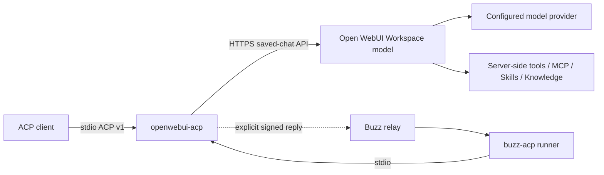

# openwebui-acp

[](https://github.com/phillamb168/openwebui-acp/actions/workflows/check.yml)

Use an Open WebUI **Workspace model as an ACP agent** in Buzz, Zed, or another ACP v1 client. A small Rust executable carries turns over stdio to Open WebUI's saved-chat API; Open WebUI runs the model and its tools.

The same binary works with arbitrary Workspace model IDs. Model prompts, generation settings, Workspace tools, MCP connections, Skills, and Knowledge stay configured in Open WebUI. Tools remain server-owned; the adapter adds neither a local tool executor nor a second function-calling loop.



This is a **0.1.0-rc.2 prerelease for early alpha testing and feature feedback**. Start with [GitHub Releases](https://github.com/phillamb168/openwebui-acp/releases) for checked downloads, or build from source below. See [tested compatibility](docs/COMPATIBILITY.md), [release artifacts](docs/RELEASE.md) and the [publication process](docs/PUBLIC_RELEASE.md) before selecting a version. It is an adapter for a particular runtime, not a general agent orchestrator.

## Choose an installation

| Use case | Start here |
| --- | --- |
| Run a Workspace model from Buzz Desktop or Zed | [First installation](docs/SETUP.md) |
| Keep a Buzz agent running on a Linux VM | [Docker Compose guide](deploy/sidecar/README.md) |
| Run the agent beside an existing Kubernetes relay | [Helm chart and relay guide](deploy/chart/README.md) |
| Validate without real accounts or provider charges | [Disposable test suite](docs/TESTING.md) |

The VM and Kubernetes packages run one outbound-only Buzz runner plus this adapter. They do not install Open WebUI, deploy task environments, or maintain a client knowledge library. The Kubernetes package works alongside Buzz's separately maintained relay chart.

## Build and run

Build with Rust 1.98.1 and a C toolchain on macOS or Linux. With rustup installed, this repository's toolchain file selects the required version. The first build needs access to crates.io and the pinned public Buzz Git repository. Dependencies are locked; no registry install is advertised yet. Python 3.11+ is needed for release scripts and Docker/Compose for the optional integration tests, not for running the executable.

```sh
git clone https://github.com/phillamb168/openwebui-acp.git
cd openwebui-acp
cargo build --locked --release
install -m 700 -d "$PWD/private-config"
install -m 600 /path/to/your/openwebui-key "$PWD/private-config/api-key"
./target/release/openwebui-acp \
  --url https://webui.example.org \
  --model your-workspace-model-id \
  --api-key-file "$PWD/private-config/api-key"
```

The executable waits for ACP JSON-RPC on stdin; it is not an interactive terminal chat. Configure your ACP client to launch it. First check the account/API requirements in [SETUP.md](docs/SETUP.md), including Open WebUI 0.12.0's User Status prerequisite. stdout contains only ACP, and diagnostics use stderr.

Downloadable archives cover macOS ARM64 and Linux ARM64/x64 with glibc 2.34 or newer. The archives include checksums, build metadata and dependency notices; verify and extract them as described in [RELEASE.md](docs/RELEASE.md). Binaries are unsigned, and macOS binaries are not notarized. Windows, macOS Intel and musl/Alpine binaries are not validated release targets.

Credential files and explicit `--env-file` files must be owned by the running user, regular files with mode 0600 or stricter, and have no symlinks or hard links. An adjacent `.env` is never loaded automatically. CLI values override process environment, which overrides the explicitly selected environment file. Keep credentials out of command arguments and client settings; use key-file paths.

HTTPS is required by default. `--allow-insecure-http true` exists for disposable local tests and explicitly trusted private transport; it sends credentials without TLS. Use a valid trusted certificate for deployments.

## Ordinary ACP clients

[Zed's custom-agent configuration](https://zed.dev/docs/ai/external-agents#custom-agents) accepts the executable directly. Adapt [examples/zed-settings.json](examples/zed-settings.json), using absolute paths. Each ACP session uses its own saved Open WebUI chat; subsequent turns use that chat's message tree.

Add `--state-dir /absolute/private/state` to opt into restart continuity. The adapter then advertises `session/load` to ordinary ACP clients. The client must retain the ACP session ID and call `session/load`; a new ACP session still creates a new chat. No session listing/import API is advertised.

ACP filesystem, terminal, attachments, and caller-provided MCP servers are not bridged. The remote model cannot access the client's local working directory. Tools available in the ACP editor are not automatically available in Open WebUI.

## Buzz

Buzz needs a real channel reply, in addition to ACP text. Enable the explicit Buzz integration and specify both requester public keys and channel UUIDs. Requesters can be people or designated delegating agents. There is no implicit permission for the owner's other agents.

```sh
openwebui-acp --env-file /absolute/private/agent.env \
  --buzz-auto-publish true --state-dir /absolute/private/agent-state
```

See [.env.example](.env.example) and [examples/buzz-harness.json](examples/buzz-harness.json). Buzz supplies its own agent identity to managed processes. In headless mode, configure the runner's identity explicitly. Replies are signed using the official Buzz SDK and sent to the validated thread and requester; model-generated `@names` stay literal and cannot add notification recipients.

Thread isolation is specific to this adapter. With persistence, the same relay, bot, channel, and thread resumes the same Open WebUI chat across process restarts. A signed outbox preserves a pending reply and retries its exact event ID; uncertain model/tool submissions are reconciled by reading the saved chat, never blindly replayed. See [recovery and retention](docs/RECOVERY.md).

Use [the Linux sidecar example](deploy/sidecar/README.md) to run `buzz-acp` and this adapter beside a separately managed relay. The adapter itself needs neither Docker nor a daemon. One instance and credential/state set belongs to one trusted team or client. This example does not provision coding subscriptions, share subscription entitlements, or create task containers.

## Boundaries to understand

- Open WebUI remains responsible for authentication, tool authorization, approvals, and model behavior. ACP-side prompts are not an enforceable read-only tool policy.
- A shared Open WebUI account shares that account's accessible data and tool identity. Thread isolation does not provide tenant isolation or erase server-side memory.
- Saved chats are retained in Open WebUI. Optional local state includes identifiers and a history fingerprint; an undelivered outbox contains its reply text until acknowledgement.
- The adapter currently reports the completed answer after polling the saved chat. It does not stream live token/tool progress or implement an interactive ACP approval bridge.
- Saved-chat APIs and Buzz's transport envelope are version-sensitive. Unsupported or ambiguous state fails visibly instead of silently starting over.

Read [SECURITY.md](SECURITY.md), the [architecture](docs/ARCHITECTURE.md), and the [audit dispositions](docs/AUDIT.md). Run the [offline and disposable integration tests](docs/TESTING.md) before upgrading a runtime or SDK.

Contributions are welcome; start with [CONTRIBUTING.md](CONTRIBUTING.md). You can run the ordinary test suite without an Open WebUI account, provider subscription or VPN. Use [Discussions](https://github.com/phillamb168/openwebui-acp/discussions) for setup questions, use cases and feature ideas, [issues](https://github.com/phillamb168/openwebui-acp/issues) for sanitized bug reports, and [private vulnerability reporting](https://github.com/phillamb168/openwebui-acp/security/advisories/new) for security issues. Never include credentials or customer conversations.

MIT licensed. Dependency and upstream notices are in [THIRD_PARTY_NOTICES.md](THIRD_PARTY_NOTICES.md).
